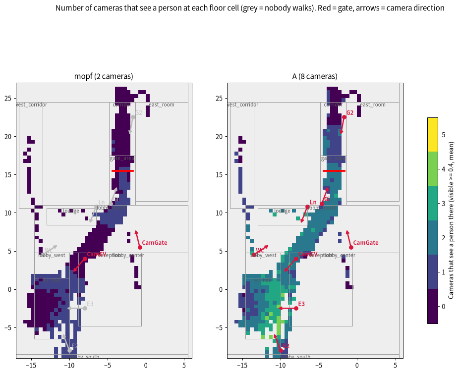
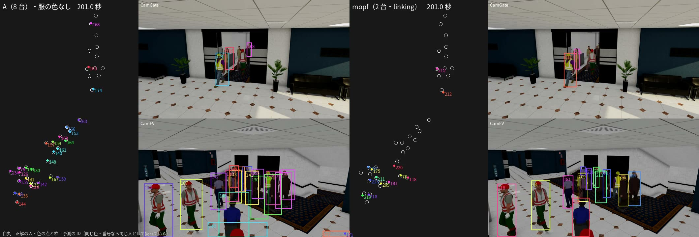
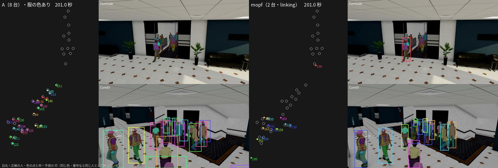

# Floor-plane tracking (A) compared with with-mopf (2026-11-25)

[日本語](README.md)

We compared the floor-plane tracker A on `feature/bev` (`twinsim/bev`: detections from several cameras become points on the floor, are fused and tracked on the floor)
with the two-camera linking on the `with-mopf` branch (each camera is tracked on its own, and the two cameras' IDs are linked by expected arrival time, walking direction and clothing colour),
on the same videos. All images are of a virtual scene. Usage is in [bev-tracking.en.md](../../bev-tracking.en.md), the rules in [bev-design.en.md section 5.4](../../bev-design.en.md).

## 1. Scene and cameras

The scene is `office_gate_ev` (an office lobby, 300 s of the morning, 182 people, 10 fps). Only the cameras were replaced, and the same motion was rendered twice:

- **With clothing colour**: each person gets their own clothing colour (the scenario default `render.tint: per_person`, as in the with-mopf renders)
- **Without clothing colour**: clothing colours are not changed (people with the same model look alike)

The cameras are the minimum needed to connect the gate and the EV hall. Too much overlap hurts: detections of the same person land at slightly different floor points and IDs get mixed up.
On the other hand, the crowded EV hall needs 3 cameras from different directions, or neighbours swap IDs (section 4).

| Place | Cameras |
|---|---|
| Outside the gate, gate | G2, Gi, CamGate |
| Link from the gate to the EV hall | Ln, Wc |
| EV hall | E2, E3, CamEV |

mopf uses the same 2 cameras as with-mopf: CamGate and CamEV.



With mopf's 2 cameras, the link corridor and the area outside the gate are seen by 0–1 cameras. With 8 cameras, the link is seen by 2 or more and the EV hall by 2–4.

## 2. Method

| | A (8 cameras) | mopf (2 cameras) |
|---|---|---|
| Detection | PeopleNet (`bev-detect --detector peoplenet`) | Same detections |
| Tracking | Fuses the 8 cameras on the floor (default settings, not tuned for this scene) | Per camera (a ByteTrack-like stand-in, not MOPF's real BoostTrack) |
| Linking the 2 cameras | Not needed: one track on the floor | with-mopf's linking `hc:time*+color` (arrival time, direction, clothing colour) |
| Extent | No `area` in the group (wherever the group's cameras see the floor) | CamGate, CamEV |

Scoring follows mopf. Ground truth = people seen by CamGate or CamEV (visible ≥ 0.4), within the floor those 2 cameras see.
People not seen by the 2 cameras are not counted, even if A tracks them.

- **Floor IDF1**: floor positions are matched to the ground truth within 1 m. For mopf, the box feet are projected onto the floor.
- **IDF1 on the 2 cameras' images**: boxes on the 2 cameras' images are matched to the ground truth at IoU 0.3. For A, a person-sized cylinder is built at the floor position and projected into a box.
- **Handovers between cameras**: of the people who moved between the 2 cameras (155 times), the share that kept the same ID.

## 3. Results

| | Floor IDF1 | IDF1 on the 2 cameras' images | ID switches (floor) | Handovers kept under one ID |
|---|---|---|---|---|
| With colour: A (8 cameras) | 0.702 | 0.605 | **373** | **0.86** |
| With colour: mopf (2 cameras) | **0.720** | **0.715** | 515 | 0.57 |
| Without colour: A (8 cameras) | **0.690** | 0.585 | **421** | **0.86** |
| Without colour: mopf (2 cameras) | 0.592 | 0.585 | 617 | 0.29 |

- **With clothing colour**, mopf is better.
- **Without clothing colour**, A is better. mopf's linking relies on clothing colour, so without colour differences it rarely keeps a handover (0.57 → 0.29). A does not use colour and barely changes.
- A keeps handovers better in both conditions: it follows one track on the floor, so it does not have to infer the link.
- The image score is unfavourable to A: boxes made from floor positions also appear for people who are hidden. Even a track made from the ground-truth positions reaches only about 0.78 (measured with the hand-drawn extent).

A on the left, mopf on the right. Coloured dots and boxes are predicted IDs (same number = treated as the same person); white circles are the ground-truth people.

Without clothing colour (201 s; only A tracks the 2 people at the bottom left of CamEV):



With clothing colour (same time):



## 4. Why A switches IDs

- Most of A's switches are neighbours swapping IDs in the crowded EV hall. The new ID is often one another person used shortly before (about 60%).
- The tail of the floor position error (0.65 m) is close to the spacing between people in the EV hall (0.92 m). A slightly larger error makes a neighbour's track the closer one.
- Seeing the EV hall with 3 cameras from different directions (E2, E3, CamEV) pins positions down and reduces switches. With 7 cameras (without CamEV), the EV hall had about twice as many switches.
- mopf's EV-hall switches are mostly a track breaking and getting a new ID, not swaps with neighbours.

## 5. Findings

- **Do not write an evaluation area.** We first drew the extent by hand, but A drops detections that fall outside it before association, so it ignored people walking on the east side of the EV hall although they were seen. We removed `area` and use all floor the cameras see (the values in this report).
- **More cameras is not always better.** What helps is seeing the links and seeing crowded spots with 3 cameras from different directions.
- **A starts a track only when 2 or more cameras see a person.** People seen by one camera only (for example in the corridor outside the gate) are not tracked.

## 6. Remaining

- Replace mopf's per-camera tracking with real MOPF output (YOLO11m + QAQS + BoostTrack) and compare again (`bev-mopf import --tracks` reads it).
- Tune A for this scene. Use appearance (clothing colour) inside A's tracking.

## 7. How to run

Add groups without `area` to the scenario's `camera_groups`.

```yaml
camera_groups:
  s8n: {cameras: [G2, Gi, CamGate, Ln, Wc, E2, E3, CamEV]}
  mopf2n: {cameras: [CamGate, CamEV]}
```

```bash
twinsim bev-detect runs/x --detector peoplenet --group s8n --name pn8 --gpu 0 --models <PeopleNet weights>
twinsim bev-track runs/x --dets pn8 --group s8n --label a8
twinsim bev-mopf tracks runs/x --cameras CamGate CamEV --dets pn8        # per-camera tracks -> mopf_tracks_pn8/
# linking on the with-mopf branch (hc:time*+color) -> mopf_eval/links.json
twinsim bev-mopf import runs/x --group mopf2n --tracks runs/x/mopf_tracks_pn8
twinsim bev-mopf compare runs/x --tracker A8=a8/s8n --tracker mopf2=mopf/mopf2n --area-group mopf2n
```

For the floor IDF1, A's result was scored as group `mopf2n` (copy `bev_tracks/a8/s8n/` to `bev_tracks/a8_on2/mopf2n/` and run `bev-eval --tracker a8_on2 --group mopf2n`).
