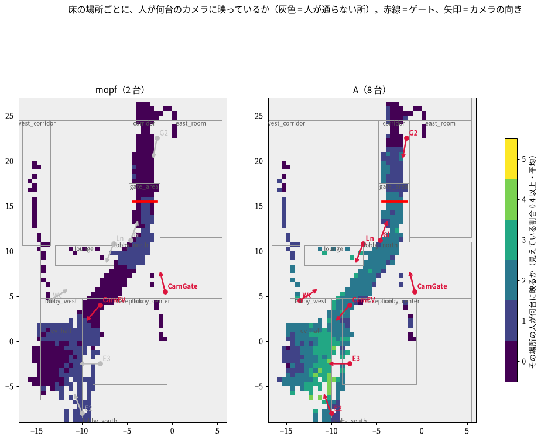
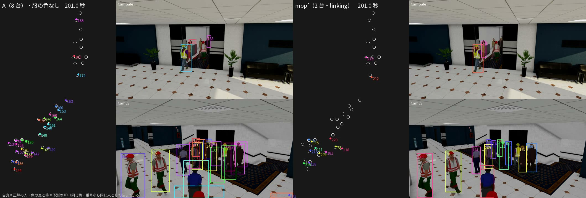
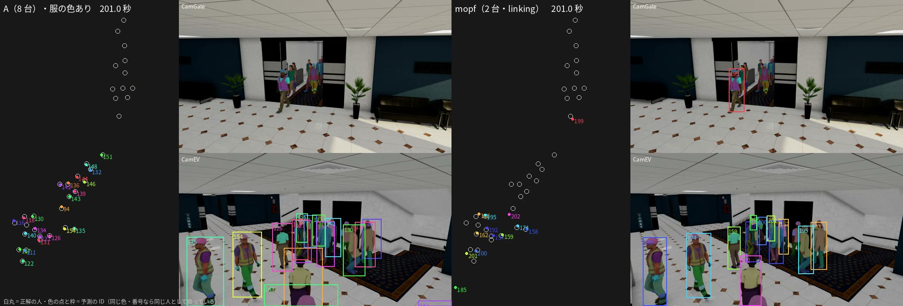

# 床の上の追跡（A）と with-mopf の比べ（2026-11-25）

[English](README.en.md)

`feature/bev` の床の上の追跡器 A（`twinsim/bev`。複数のカメラの検出を床の上の点にして束ね、床の上で追う）と、
ブランチ `with-mopf` の 2 台のつなぎ（カメラごとに追跡し、来る時間・歩く向き・服の色で 2 台の ID をつなぐ）を、同じ動画で比べた。
画像はすべて仮想の場面。使い方は [bev-tracking.md](../../bev-tracking.md)、決まりは [bev-design.md の 5.4](../../bev-design.md)。

## 1. 場面とカメラ

場面は `office_gate_ev`（オフィスのロビー、朝の 300 秒、182 人、10 fps）。カメラだけを置き換え、同じ人の動きを 2 通りに描画した。

- **服の色あり**: 人ごとに服の色を変える（シナリオの既定 `render.tint: per_person`。with-mopf の描画と同じ）
- **服の色なし**: 服の色を変えない（同じモデルの人は同じ服に見える）

カメラは「ゲートと EV 前をつなぐのに要る最低限」で選んだ。重なりが多すぎると、同じ人の検出が床の上でずれて重なり、かえって ID を取り違える。
一方で、混む EV 前は向きの違う 3 台で見ないと、隣の人と ID が入れ替わる（4 節）。

| 場所 | カメラ |
|---|---|
| ゲートの外・ゲート | G2、Gi、CamGate |
| ゲートから EV 前へのつなぎ | Ln、Wc |
| EV 前 | E2、E3、CamEV |

mopf は with-mopf と同じ CamGate・CamEV の 2 台。



mopf の 2 台では、つなぎの通路とゲートの外が 0〜1 台になる。8 台では、つなぎも 2 台以上で見え、EV 前は 2〜4 台になる。

## 2. 比べ方

| | A（8 台） | mopf（2 台） |
|---|---|---|
| 検出 | PeopleNet（`bev-detect --detector peoplenet`） | 同じ検出 |
| 追跡 | 床の上で 8 台を束ねて追う（設定は既定、この場面に合わせて調整していない） | カメラごとに追跡（ByteTrack に似た代わりの追跡。本物の MOPF の BoostTrack ではない） |
| 2 台のつなぎ | 床の上で同じ軌跡なので要らない | with-mopf の linking `hc:time*+color`（来る時間・向き・服の色） |
| 範囲 | 群に `area` を書かない（群のカメラから床が見える所すべて） | CamGate・CamEV |

採点は mopf に合わせた。正解は CamGate・CamEV のどちらかに映った人（見えている割合 0.4 以上）で、範囲はその 2 台から床が見える所。
2 台に映らない人は、A が追っていても数えない。

- **床の上の IDF1**: 床の上の位置を 1 m 以内で正解と対応させる。mopf は枠の足元を床に写す。
- **2 台の画面の IDF1**: 2 台の画面の枠を IoU 0.3 で正解と対応させる。A は床の位置から人の形の円柱を作って枠にする。
- **カメラの間の移り**: 2 台の間を移った人（155 回）のうち、同じ ID のままだった割合。

## 3. 結果

| | 床の上の IDF1 | 2 台の画面の IDF1 | ID の切り替わり（床の上） | カメラの間の移りを同じ ID でつないだ割合 |
|---|---|---|---|---|
| 服の色あり: A（8 台） | 0.702 | 0.605 | **373** | **0.86** |
| 服の色あり: mopf（2 台） | **0.720** | **0.715** | 515 | 0.57 |
| 服の色なし: A（8 台） | **0.690** | 0.585 | **421** | **0.86** |
| 服の色なし: mopf（2 台） | 0.592 | 0.585 | 617 | 0.29 |

- **服の色あり**では mopf のほうが良い。
- **服の色なし**では A のほうが良い。mopf はつなぎの決め手が服の色なので、色の差がないとカメラの間の移りをほとんどつなげない（0.57 → 0.29）。A は色を使わないので、ほぼ変わらない。
- カメラの間の移りは、どちらの条件でも A が強い。床の上で同じ軌跡のまま追うので、つなぎ目を推論しなくてよい。
- 2 台の画面の採点は A に不利。床の位置から作った枠は、隠れて見えない人の分も出る。正解の位置から作った追跡でも約 0.78 にとどまる（手で描いた範囲での値）。

左が A、右が mopf。色の点・枠は予測の ID（同じ番号なら同じ人として扱っている）、白丸は正解の人。

服の色なし（201 秒。CamEV の左下の 2 人は A だけが追っている）:



服の色あり（同じ時刻）:



## 4. A の ID の切り替わりの原因

- A の切り替わりの多くは、混む EV 前で隣の人と ID が入れ替わるもの。入れ替わった先は、別の人が少し前まで使っていた ID が多い（約 6 割）。
- 床の上の位置の誤差の裾（0.65 m）が、EV 前の人の間隔（0.92 m）に近い。誤差が少し大きいと、隣の人の軌跡のほうが近くなる。
- EV 前を向きの違う 3 台（E2・E3・CamEV）で見ると、位置が定まり切り替わりが減る。CamEV を外した 7 台では、EV 前の切り替わりが約 2 倍だった。
- mopf の EV 前の切り替わりは、追跡が途切れて新しい ID になるものが多い（隣との入れ替わりではない）。

## 5. 気づいたこと

- **評価領域は書かないほうがよい。** はじめは範囲を手で描いたが、A は範囲の外に落ちた検出をつなぐ前に捨てる。そのため、EV 前の東側を歩く人を見えているのに追わなかった。`area` を書かず、床が見える所すべてにした（この報告の値）。
- **カメラは多ければよいのではない。** つなぎ目が映ること、混む所を向きの違う 3 台で見ることが効く。
- **A は 2 台以上に映らないと新しい軌跡を作らない。** 1 台にしか映らない所（ゲートの外の通路など）の人は追わない。

## 6. 残り

- mopf のカメラごとの追跡を、本物の MOPF（YOLO11m＋QAQS＋BoostTrack）の出力に置き換えて比べ直す（`bev-mopf import --tracks` で読める）。
- A の設定をこの場面に合わせる。A の追跡の途中で見た目（服の色）を使う。

## 7. やり方

シナリオの `camera_groups` に、`area` を書かない群を書く。

```yaml
camera_groups:
  s8n: {cameras: [G2, Gi, CamGate, Ln, Wc, E2, E3, CamEV]}
  mopf2n: {cameras: [CamGate, CamEV]}
```

```bash
twinsim bev-detect runs/x --detector peoplenet --group s8n --name pn8 --gpu 0 --models <PeopleNet の重み>
twinsim bev-track runs/x --dets pn8 --group s8n --label a8
twinsim bev-mopf tracks runs/x --cameras CamGate CamEV --dets pn8        # カメラごとの追跡 → mopf_tracks_pn8/
# with-mopf のブランチで linking（hc:time*+color）→ mopf_eval/links.json
twinsim bev-mopf import runs/x --group mopf2n --tracks runs/x/mopf_tracks_pn8
twinsim bev-mopf compare runs/x --tracker A8=a8/s8n --tracker mopf2=mopf/mopf2n --area-group mopf2n
```

床の上の IDF1 は、A の結果を群 `mopf2n` として採点した（`bev_tracks/a8/s8n/` を `bev_tracks/a8_on2/mopf2n/` に写して `bev-eval --tracker a8_on2 --group mopf2n`）。
